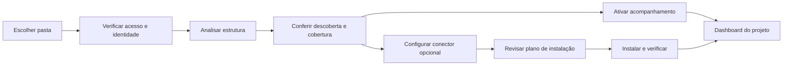
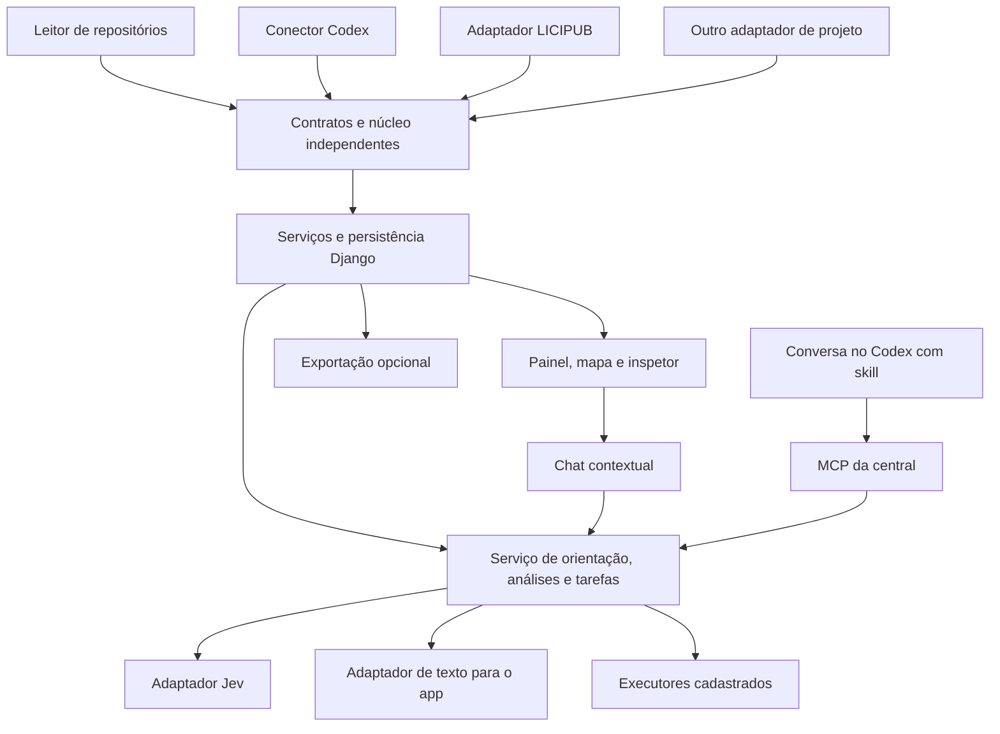

# SPEC — Central de Projetos

**Versão:** 0.2 · **Data:** 29/09/2026 · **Estado:** revisão da especificação concluída; sem implementação ou aprovação visual.

**Responsável pelo produto:** Juan. **Nome de trabalho:** Central de Projetos. **Destino proposto para a implementação:** `C:/Users/juanm/OneDrive/Desktop/WORKSPACE/APPS/CENTRAL_PROJETOS`.

Esta versão substitui a spec 0.1. Preserva a central por pastas, dashboards, mapa e inspetor, e incorpora o assistente compartilhado entre app e Codex, a avaliação de objetivos e gargalos com Jev, a preparação de tarefas e a configuração futura por `.env`. Nesta entrega não se cria o app, não se instala conector e não se modifica nenhum projeto acompanhado. A versão anterior permanece como histórico.

**Percurso principal:** adicionar pasta → conferir cobertura → abrir dashboard/mapa → conversar sobre um objetivo → examinar análise e evidências → preparar o próximo passo. A central compartilha seu catálogo e seu analista com o Codex por MCP e skill; os perfis e adaptadores mantêm as particularidades de cada projeto encapsuladas.

## 1. Produto e resultado esperado

A Central de Projetos é uma aplicação Django local para acompanhar os projetos administrados pelo Codex. O usuário escolhe uma pasta, confere o que foi identificado e ativa o acompanhamento. Depois acessa cada projeto para entender sua arquitetura agêntica, as regras aplicáveis, as execuções observadas e as oportunidades de melhoria.

A experiência deve permitir responder, sem percorrer manualmente dezenas de arquivos:

- O que este projeto faz e quais fluxos possui?
- Quais skills, regras, contratos, agentes e ferramentas participam de cada fluxo?
- O que aciona cada elemento e quais são suas entradas, saídas e dependências?
- O que aconteceu em uma execução, em qual versão, com quais resultados?
- Onde há demora, repetição, falha, conflito potencial ou falta de observação?
- Quais outros projetos podem ser afetados por uma mudança compartilhada?
- Qual projeto e qual fluxo ajudam a realizar uma tarefa, como criar um site ou um vídeo?
- A arquitetura atende ao objetivo declarado, com quais evidências e quais lacunas?
- Qual próximo passo é útil e pode ser preparado ou executado pelo projeto escolhido?

**As duas frentes têm o mesmo peso:** desenvolvimento pelo Codex e execução de IA dentro dos aplicativos. São vistas conectadas, com fontes de evidência diferentes. Uma lista de arquivos não será apresentada como prova de execução.

O usuário principal é o responsável por vários projetos. A primeira instalação é local, de uso administrativo. O desenho permite outros usuários autorizados e outros coletores depois, sem introduzir compartilhamento público no primeiro produto.

### 1.1 Decisões fechadas nesta proposta

| Tema | Decisão |
|---|---|
| Organização | Uma central independente, com seleção de projeto; não uma cópia do painel em cada app |
| Reutilização | Núcleo comum, contratos versionados, conectores e adaptadores por projeto |
| Base de produto | Adotar seletivamente infraestrutura e shell operacional do DJANGO_LANDPAGE |
| Primeiro projeto | LICIPUB; segundo caso para comprovar reuso: SOCIAL_APP |
| Entrada | Escolha de pasta no computador onde o coletor local opera |
| Leitura inicial | Somente leitura; não executar scripts encontrados no projeto |
| Interface | Clara, elegante, moderna, visual e com descrições progressivas |
| Mapa | Fluxos orientados, seleção com destaque das conexões e ações por ícones |
| Inspetor | Um modal com abas Elemento e Fluxo; detalhes e estrutura de suporte recolhidos |
| Assistente | Parte da primeira versão funcional; serviço compartilhado com perfis por projeto, sem um processo autônomo permanente para cada app |
| Jev | Avaliação tipada de pertinência, critérios e contrapontos; conclusões vinculadas a evidências |
| Conversa | Modelo de linguagem para diálogo e explicação; no app, provedor configurável; no Codex, o modelo da conversa usa as ferramentas da central |
| Integração Codex | MCP para dados e ações controladas, acompanhado de skill com o roteiro de uso |
| Configuração | `.env` próprio da central, com `JEV_IA` conforme os projetos existentes; credenciais não são copiadas dos apps |
| Autoridade | Regras canônicas continuam nos projetos; a central referencia e registra evidências |
| Entrega atual | Apenas esta spec |

## 2. Limites de escopo

### 2.1 Primeira versão funcional completa

Inclui cadastro por pasta, leitura incremental, dashboard da carteira e do projeto, inventário, mapas, inspetor, exploração segura de fontes, diferenças entre snapshots, acompanhamento da coleta e integração de uma execução de desenvolvimento e uma execução de produto no piloto. Inclui também chat contextual, descoberta de capacidades, análise de objetivos/gargalos com Jev, histórico das avaliações e acesso aos mesmos serviços pelo Codex.

O assistente prepara tarefas para os projetos e executa ações cadastradas quando houver conector compatível e autorização suficiente. O primeiro executor do piloto será a atualização de inventário da própria central, sem custo de IA. Tarefas amplas de criação de sites, vídeos ou alteração de código geram um pacote de trabalho acionável; a execução integrada desses processos depende de executor próprio. Essa diferença precisa estar visível em cada sugestão.

O inventário e a navegação funcionam sem provedores de IA configurados. A indisponibilidade de um provedor reduz explicitamente a capacidade do assistente; não desaparece com uma resposta simulada.

O produto também deve cadastrar projetos sem Django, sem Git ou sem IA. Nesses casos, identifica as capacidades disponíveis e apresenta o que consegue observar. Uma ausência não impede o inventário básico nem vira erro de saúde.

### 2.2 Evoluções posteriores

Comparação avançada entre projetos; exportação para Obsidian; integração opcional com uma plataforma de traces; coletores em outras máquinas; análises recorrentes explicitamente configuradas; componente administrativo embutível nos apps; executores especializados para produção de sites, vídeos e outros processos. O chat e a análise sob demanda pertencem à primeira versão.

### 2.3 Fora da primeira versão

Editar ou aprovar regras automaticamente, migrar a arquitetura dos apps, comandar deployments, publicar mudanças, promover skills ao template, abrir processos dos projetos por conta própria, executar comandos extraídos de arquivos ou substituir a interface do Codex. Não haverá editor visual que transforme o desenho em um novo motor de execução, nem interpretação de texto livre como autorização irrestrita para shell.

## 3. Cadastro, instalação e acompanhamento por pasta

O botão principal da carteira é **Adicionar projeto**. O processo usa etapas curtas, com detalhes técnicos recolhidos.

### 3.1 Escolher pasta

**ONB-01.** Oferecer um navegador de diretórios dentro das raízes locais autorizadas e um campo para colar o caminho. O seletor mostra a máquina de origem. Em uma instalação local, o backend e o coletor enxergam o mesmo computador.

**ONB-02.** A seleção não faz upload da pasta. Um navegador web remoto não ganha acesso ao disco do usuário: quando a central estiver em outro host, a experiência exigirá um coletor naquela máquina. Esse modo ficará explicitamente indisponível até existir o conector correspondente.

**ONB-03.** Verificar existência, permissão de leitura, caminho canônico e projetos já cadastrados. Reconhecer aliases de caminho e worktrees quando possível. Uma worktree recebe identidade de checkout vinculada ao projeto; não duplica a carteira automaticamente. Sem evidência suficiente de identidade comum, oferecer vincular ou cadastrar separadamente.

**ONB-04.** Não alterar Git, banco, ambiente virtual, configurações ou permissões do projeto para permitir a leitura. Ausência de Git não bloqueia cadastro. Pasta movida permite remapear a raiz preservando a identidade e o histórico.

### 3.2 Analisar e apresentar o que foi encontrado

**ONB-05.** Mostrar progresso por etapas reais: estrutura, instruções, skills, referências, relações e snapshot. Quantidade de arquivos processados é informação de progresso; porcentagem só quando o universo estiver conhecido. Permitir cancelar.

**ONB-06.** Identificar nome sugerido, stack, repositório/checkout, fontes de instrução, skills, contratos, possíveis fluxos e conectores compatíveis. A correspondência vem de regras de detecção versionadas. A detecção de um framework não prova que ele esteja executando.

**ONB-07.** A conferência contém resumo visual, itens não identificados e cobertura disponível. “Ver detalhes da leitura” revela inclusões, exclusões, origem das relações e alertas. O usuário pode ajustar nome, escopo e associação de checkout antes de ativar.

### 3.3 Ativar acompanhamento

**ONB-08.** Ativar a leitura cria registros na central; não instala nada no repositório acompanhado. Essa ação produz primeiro snapshot, agenda de atualização e dashboard. Estado inicial do runtime pode ser “Não conectado”, sem impedir o restante do produto.

**ONB-09.** Começar com leitura incremental a cada cinco minutos enquanto o serviço da central estiver ativo, além de Atualizar agora. A cadência é configurável por projeto. Não iniciar o computador nem instalar serviço do Windows no cadastro. Exibir última conclusão, próxima verificação e condição do coletor; não prometer tempo real quando há leitura periódica.

**ONB-10.** Um único trabalho pesado de inventário por vez no piloto; fila justa por projeto e cancelamento cooperativo. Agrupar mudanças próximas, ignorar arquivos inalterados e impedir duas varreduras simultâneas do mesmo checkout. Parâmetros serão ajustados por medição.

### 3.4 Instalar um conector quando necessário

**ONB-11.** A instalação tem ficha própria: capacidade que habilita, versão, compatibilidade, permissões, arquivos e configurações afetados, reinício necessário e procedimento de reversão. A descoberta de um projeto nunca equivale à autorização para executar seu código ou instalar dependências.

**ONB-12.** Antes da escrita, gerar um plano concreto. O botão Instalar aplica o plano exibido; hashes atuais devem coincidir com os revisados. Preservar mudanças preexistentes. Se o arquivo divergiu, invalidar o plano e mostrar o novo diff. Usar apenas pacotes de conectores cadastrados e confiáveis, não código arbitrário encontrado na pasta.

**ONB-13.** Registrar uma instalação uma única vez, testar a conexão e mostrar resultado. Se a integração exigir reinício, apresentar “Instalado, aguardando reinício”; não reiniciar o projeto silenciosamente. Ingestão deve tolerar reenvio sem duplicar eventos.

**ONB-14.** Desativar acompanhamento cancela novas coletas e preserva histórico. Desconectar remove acesso do conector. Desinstalar reverte somente arquivos e configurações de propriedade comprovada do conector; divergências locais exigem revisão. Remover o cadastro nunca apaga a pasta acompanhada.

## 4. Arquitetura de informação e telas

O modo predominante das telas é **Operar**; o leitor de evidências é **Ler**. Não há landing page pública nesta versão.

| Tela | Tarefa dominante | Conteúdo prioritário | Ação principal |
|---|---|---|---|
| Carteira | Encontrar e abrir um projeto | Nome, atividade, situação da coleta e disponibilidade de execução | Adicionar projeto |
| Adicionar projeto | Ativar acompanhamento correto | Pasta, detecção e capacidades | Ativar acompanhamento |
| Visão geral do projeto | Entender situação e próximo passo | Atualização, cobertura, atividade e pendências verificáveis | Abrir mapa ou completar conexão pendente |
| Mapa | Entender relações e trajetos | Fluxo, condições e elemento selecionado | Inspecionar seleção |
| Execuções | Investigar o que aconteceu | Linha do tempo, etapas, resultado e tentativas | Abrir execução |
| Mudanças | Entender diferença e impacto | Elementos/relações alterados e consumidores conhecidos | Comparar snapshots |
| Análises | Avaliar um objetivo e acompanhar melhorias | Objetivo, critérios, evidências, lacunas e decisões | Analisar objetivo ou abrir avaliação salva |
| Assistente sobreposto | Encontrar um caminho e decidir o próximo passo | Conversa curta, contexto explícito e cartões acionáveis | Perguntar, analisar ou preparar tarefa |
| Configurações do projeto | Controlar leitura e integração | Raiz, exclusões, perfil e conectores | Salvar configuração |

Sidebar da central: Projetos, Atividade e Configurações. Dentro do projeto: Visão geral, Mapa, Execuções, Análises, Mudanças e Configurações. O nome do projeto permanece visível no cabeçalho. Busca e troca de projeto preservam a separação dos dados e não carregam filtros de outro projeto por acidente. O assistente tem launcher persistente em toda a área autenticada e histórico próprio, sem criar uma segunda navegação concorrente.

### 4.1 Carteira de projetos

Coleção compacta com identidade, stack, última leitura e estado do acompanhamento. Campo de busca e filtros de situação. Cartão ou linha abre o dashboard; ações secundárias aparecem em uma faixa compacta e no teclado/toque. Usar o mesmo padrão de coleção em toda a carteira.

Resumo superior somente com dados disponíveis: projetos acompanhados, coletas que precisam de atenção e projetos com execução conectada. Não criar uma nota de saúde arbitrária. Arquivados ficam fora da lista padrão, com acesso explícito ao histórico.

### 4.2 Dashboard individual

Cabeçalho compacto com projeto, checkout/ambiente selecionado e última atualização. A área principal apresenta um resumo visual dos fluxos e acessos diretos ao mapa. Atividade e achados ocupam região secundária proporcional à quantidade de informação real.

Indicadores candidatos: fluxos catalogados; elementos identificados; mudanças desde o snapshot anterior; execuções no período; operações com falha. Exibir apenas os úteis ao contexto e nunca representar métrica indisponível como zero. Duração e custo só aparecem quando observados e com período/universo definido.

A cobertura aparece em duas dimensões: **Arquitetura** e **Execução**, com o que foi conectado e o que falta. Não usar porcentagem sem denominador definido. “Sem execução observada” e “Conector ausente” são situações diferentes.

Descrições longas ficam em “Sobre o projeto”, “O que está sendo acompanhado” e cards de ajuda recolhidos. Nome, condição de atualização, falhas que exigem ação e ação principal continuam visíveis.

Uma avaliação salva acrescenta um resumo compacto: objetivo, data/versão, situação por critério e próxima ação escolhida. Sugestão do analista não vira tarefa em execução nem problema comprovado. A carteira permite encontrar capacidades com busca textual; o chat torna essa navegação conversacional.

## 5. Mapa visual

### 5.1 Três vistas complementares

**MAP-01 — Desenvolvimento.** Pedido/contexto → instruções aplicáveis → skills/papéis → ferramentas e alterações → verificações e entregas. As relações podem ser documentadas ou inferidas; ações observadas em uma sessão aparecem apenas com evidência correspondente.

**MAP-02 — Produto.** Entrada → roteamento → etapas → ferramentas/provedores → validações → saída. O fluxo de ETP pertence ao adaptador do LICIPUB. O núcleo e a interface não conhecem regras de licitações.

**MAP-03 — Conexões entre as vistas.** Exibir referências entre regra, consumidor, versão e execução quando houver ligação verificável. Proximidade temporal não basta para afirmar causalidade. Relação ainda não estabelecida fica marcada como pendente, não desenhada como ligação comprovada.

O usuário alterna as vistas num controle compacto. Dentro de cada vista, pode escolher um fluxo ou a visão geral. A escolha de uma execução sobrepõe o trajeto observado à versão correspondente do fluxo. Sem vínculo de versão, mostrar “Versão não correlacionada”.

### 5.2 Elementos e conexões

**MAP-04.** Tipos visuais: entrada/gatilho, decisão, skill, agente/papel, ferramenta, etapa de código, verificação e saída. Usar nome curto, ícone consistente e pequeno estado quando necessário. Uma chamada de modelo isolada não vira automaticamente um agente.

**MAP-05.** Conexões de funcionamento têm direção e semântica: inicia, seleciona, chama, valida, produz, repete ou recupera. Condições de bifurcação ficam disponíveis junto à relação. Dependências documentais usam outro tipo de relação e pertencem à estrutura de suporte.

**MAP-06.** Distinguir “Documentado”, “Inferido do código” e “Observado” por marca e texto acessível, além de cor. Um elemento pode ter várias evidências; não promover toda a cadeia ao estado Observado porque um nó teve evento.

### 5.3 Seleção e destaque

**MAP-07.** Um clique ou seleção por teclado fixa o elemento, destaca suas entradas/saídas diretas e reduz o contraste dos elementos não relacionados sem torná-los ilegíveis. Mostrar direção e nomes das relações selecionadas. O layout não muda nesse gesto.

**MAP-08.** Selecionar outro elemento transfere o foco visual. Clicar no fundo ou usar Limpar seleção remove o destaque. Escape fecha primeiro o popover ou modal ativo; somente depois limpa a seleção. O destaque não é removido ao abrir e fechar o inspetor.

**MAP-09.** Oferecer “Expandir conexões” de forma explícita, com indicação de quantos níveis estão abertos. Ciclos e retomadas devem ser representados, sem recursão infinita. Quando um nó participa de vários fluxos, o inspetor pede a escolha do fluxo ou conserva o fluxo de origem do clique.

### 5.4 Ações da seleção

Uma barra contextual compacta apresenta ícones com nome acessível e tooltip. Não usar menu radial nem ações invisíveis que dependam apenas do hover.

| Ação | Comportamento |
|---|---|
| Entender elemento | Abre o modal na aba Elemento |
| Entender fluxo | Abre o mesmo modal na aba Fluxo |
| Ver suporte | Abre a aba Elemento com a estrutura de suporte expandida |
| Ver execuções | Abre a lista filtrada por elemento/fluxo; se não conectado, explica a ausência |
| Focar conexões | Ajusta o enquadramento para a seleção e suas conexões sem recalcular posições |
| Copiar link | Copia uma referência interna com projeto, snapshot, vista e elemento |
| Conversar sobre isto | Abre o assistente com o contexto da seleção anexado e visível; não envia mensagem automaticamente |
| Analisar objetivo | Abre a preparação da análise para o fluxo selecionado; mostra objetivo, fontes e uso de IA antes de iniciar |

As três ações principais ficam expostas; as demais podem ficar em Mais ações. Selecionar, inspecionar e abrir o assistente não executa skills nem chama IA. O envio da pergunta ou o comando explícito Analisar inicia a operação correspondente dentro do escopo autorizado.

### 5.5 Navegação e escala

Pan, zoom, Ajustar à tela, Centralizar seleção e busca de elemento. O mapa terá posições determinísticas por snapshot, sem física contínua. Atualizações disponíveis geram um aviso discreto; aplicar o novo snapshot é um gesto explícito, preservando seleção e enquadramento quando possível.

Começar mostrando fluxos agrupados, não todo o grafo do projeto. Projetos grandes revelam subgrafos por demanda. Quantidade de itens agrupados permanece visível, e a busca alcança o inventário completo. Não eliminar nós silenciosamente para cumprir orçamento visual.

Cada vista terá uma alternativa textual de etapas e conexões com as mesmas ações. No mobile, essa lista será a entrada padrão, com acesso ao mapa por escolha; o canvas continua disponível e navegável por toque.

## 6. Modal de inspeção e divulgação progressiva

**INS-01.** Um único modal de leitura, com título do elemento, tipo, estado da evidência e fechamento visível. Desktop: largura contida e corpo rolável. Mobile: ocupa a área útil, com título, abas e fechar persistentes. Não empilhar modais de leitura.

**INS-02.** Duas abas principais, **Elemento** e **Fluxo**. A aba ativa deve ser identificada por texto/estado acessível. Mudar de aba preserva o elemento selecionado e o contexto do mapa.

### 6.1 Aba Elemento

Camada resumida, exibida ao abrir:

- O que faz, em até duas frases curtas.
- Quando entra, numa frase ou condição.
- Principal entrada e saída, quando conhecidas.

O controle **Ver detalhes do elemento** expande finalidade completa, gatilhos, escopo, restrições, consumidores conhecidos, versão e evidências. Informação ausente aparece como “Não identificado”; não é preenchida por hipótese silenciosa.

### 6.2 Aba Fluxo

Camada resumida: objetivo, pequeno trajeto ordenado e posição do elemento selecionado. Não repetir o texto da aba Elemento. Escolha de fluxo apenas quando houver mais de um contexto possível.

O controle **Ver detalhes do fluxo** expande condições de entrada, ramos, ordem/concorrência, verificações, pontos de retomada, saídas e limites de observação. Se a origem for uma execução, mostrar também tentativas e resultado observado; o funcionamento previsto continua identificado separadamente.

### 6.3 Estrutura de suporte

**INS-03.** Em cada aba, uma região recolhida chamada **Estrutura de suporte**, separada do funcionamento por divisor, subtítulo e superfície secundária. Nela ficam pastas, arquivos, instruções, regras, contratos, scripts e referências relacionados ao contexto daquela aba.

**INS-04.** Mostrar agrupamentos por função, por exemplo “Instruções”, “Implementação”, “Contratos” e “Verificações”. Pastas são contêineres de navegação, não etapas do fluxo. Selecionar uma fonte mostra por que ela se relaciona ao elemento ou fluxo.

**INS-05.** Clicar num arquivo abre um leitor dentro do próprio modal, com caminho, breadcrumb, versão/hash, seção ou linha de origem e ação Voltar. Fechar o leitor restaura a aba e a posição anterior. Markdown e código são conteúdo de leitura, não instruções para a central executar.

**INS-06.** Exibir a evidência do snapshot quando disponível. Abrir arquivo atual é uma ação distinta e mostra quando ele diverge do snapshot. Arquivos removidos preservam referência histórica; sem conteúdo arquivado, indicar indisponibilidade em vez de substituir pelo arquivo atual.

**INS-07.** Leitura de conteúdo é autorizada por projeto, tipo de arquivo e caminho. Conteúdo longo usa carregamento por trecho com indicação de extensão e limites; texto ilegível, binário, excluído ou sem permissão tem estado próprio. Não tratar um trecho carregado como leitura integral.

### 6.4 Tooltips e cards de ajuda

Tooltips simples dão nomes às ações. Ajuda com mais informação usa um **card de ajuda** ancorado, aberto por foco/clique/toque e dispensável por Escape. Se houver links ou ações, o componente se comporta como popover, com foco controlado, não como tooltip inacessível.

Não abrir ajuda sobre ajuda. O clique num botão de ação executa sua ação; o tooltip não captura esse clique. Cards fixados por clique preservam posicionamento e não desaparecem devido ao auto-scroll do foco.

### 6.5 Exemplo funcional no LICIPUB

Ao selecionar a skill documental, o mapa destaca as relações registradas. “Entender elemento” abre um resumo de sua função de orientar o desenvolvimento. “Ver suporte” permite ler a skill e as fontes associadas. A aba Fluxo mostra o contexto escolhido de desenvolvimento; ela não afirma que o chat do LICIPUB executou aquela skill.

Na vista Produto, o fluxo de novos ETPs aparece com seu escopo específico. Regras de planos anteriores ficam em outro fluxo ou versão. A documentação inspecionada no brainstorm explicita essa coexistência; o caso é um teste obrigatório contra mistura de rotas.

## 7. Contrato de frontend

Este contrato é requisito da implementação, não uma aprovação visual antecipada. O desenho final será validado em telas representativas antes de se propagar.

| ID | Regra obrigatória |
|---|---|
| UI-01 | Adotar o shell operacional do template por capacidade versionada; um shell consistente para toda a central |
| UI-02 | Priorizar o mapa e as informações que orientam decisão; descrições longas começam recolhidas |
| UI-03 | Manter nomes, estados, alertas acionáveis e ações principais visíveis; não esconder informação essencial em tooltip |
| UI-04 | Direção inicial clara e neutra: fundos suaves, superfícies claras, texto de alto contraste, bordas discretas e acento contido |
| UI-05 | Tipografia de sistema, hierarquia compacta e escala consistente; nada de fontes e cores próprias por tela |
| UI-06 | Usar cores semânticas com rótulos e formas; não atribuir uma cor decorativa a cada nó |
| UI-07 | Reservar cartões para unidades autônomas e ajuda; evitar grades de métricas sem função e caixas aninhadas |
| UI-08 | Ícones de uma família única, com nome acessível, foco visível e área de toque confortável |
| UI-09 | Templates, CSS, scripts e modal de domínio pertencem ao app dono; globais guardam apenas infraestrutura comum |
| UI-10 | CSS externo com tokens; JavaScript em módulos locais. Preservar CSP, CSRF e escape de conteúdo; não relaxar a política para acomodar o grafo |
| UI-11 | Abertura/fechamento de modal, scroll lock, Escape e restauração de foco usam um contrato comum; evitar listeners concorrentes |
| UI-12 | Pan e zoom não movem o resto da página; seleção não recalcula o layout; atualizações não trocam itens sob o cursor |
| UI-13 | Animações somente para mudança de estado/enquadramento, com opção de movimento reduzido; sem pulsos permanentes ou fundo animado |
| UI-14 | Carregamento, vazio, erro, parcial, desconectado e desatualizado conservam a estrutura da tela e oferecem um próximo gesto |
| UI-15 | Sem JavaScript, cadastro básico, listas, fontes e navegação continuam úteis; o mapa tem alternativa textual |
| UI-16 | Mobile recompõe por prioridade; não comprime o grafo desktop até os rótulos ficarem ilegíveis |
| UI-17 | Launcher do assistente discreto, com nome acessível; não cobre controles do mapa, alertas, rodapé fixo ou área segura do mobile |
| UI-18 | Chat mantém contexto e situação da operação visíveis; respostas iniciais curtas, fontes/detalhes recolhidos e ações com rótulos inequívocos |
| UI-19 | Um único controlador de camadas coordena chat, inspetor e popovers; nunca dois modais empilhados ou dois focos aprisionados |

### 7.1 Critérios objetivos de acabamento

- Testar larguras de 1440, 1024, 768, 390 e 320 px, além de viewport baixa.
- Nenhuma rolagem horizontal da página; movimento horizontal fica dentro do canvas quando necessário.
- Rótulos de leitura corrente com alvo de 14 px ou mais; rótulos secundários do mapa legíveis e nunca reduzidos para acomodar um grafo inteiro.
- Texto normal com contraste mínimo de 4,5:1; foco e controles identificáveis contra o fundo real. Cores translúcidas são medidas após composição.
- Controles de toque com alvo próximo de 44 × 44 px; ícones podem ser visualmente menores dentro da área acionável.
- Testar conteúdo longo, caminhos extensos, múltiplas conexões, zoom do navegador e todas as abas/expansões.
- Usar capturas reais para conferir hierarquia, espaçamento, densidade, clipping, sobreposição e recomposição mobile. Testes de HTML não encerram QA visual.

### 7.2 Artefatos de governança a criar na implementação

`PROJETO.md` registrará produto e escopo. `IDENTIDADE.md` registrará comportamento e direção; os valores ficarão nos tokens administrativos/skin previstos pelo template. Um contrato específico da interface guardará mapa, inspetor e divulgação progressiva. Esses arquivos nascerão dentro do novo projeto, após esta etapa de spec.

As skills próprias deverão rotear para as regras responsáveis, sem copiar os manuais do template. A criação ou especialização de skills seguirá a skill oficial de criação. As skills de frontend efetivamente usadas em cada mudança devem ser informadas no plano de trabalho.

Depois da validação visual, registrar a referência aprovada com fontes, capturas desktop/mobile e hashes. A aprovação da spec não equivale à aprovação da aparência implementada.

## 8. Motor de descoberta e qualidade do conhecimento

### 8.1 Perfis de leitura versionados

**COL-01.** Perfis descrevem arquivos elegíveis, reconhecedores, resolutores e exclusões. Começar por instruções, skills, documentos de arquitetura e configurações explicitamente admitidas. Acrescentar análise estática de código por adaptador, sem importar ou executar o projeto.

**COL-02.** Não percorrer tudo indiscriminadamente. Excluir ambientes virtuais, dependências instaladas, caches, binários, backups, bancos, anexos e segredos. Contratos e manifestos legíveis podem ser habilitados por padrão; dados de negócio e logs brutos não. Listar as exclusões aplicadas.

**COL-03.** Arquivos referenciados fora da raiz só serão resolvidos se pertencentes a outra raiz autorizada. Links simbólicos/junctions, caminhos relativos e aliases passam por resolução canônica antes da leitura. Referência externa não autoriza ampliar a área de acesso.

**COL-04.** Indexar fontes globais do Codex somente quando explicitamente cadastradas no perfil. Não presumir que tudo em uma pasta global estava disponível em uma sessão. A instrução efetiva pode depender de escopo, host, overrides e contexto que só os eventos daquela sessão demonstram.

**COL-05.** Para cada instrução, skill, regra ou contrato, registrar origem, versão, escopo de arquivos/tarefas, gatilho declarado e relações de referência ou substituição identificadas. O perfil do host define como resolver escopos e precedência; não impor uma ordem universal a todo projeto. Sobreposição sem resolução demonstrada aparece como questão de escopo, com as fontes lado a lado. Uma referência externa não encontrada permanece pendente, sem ser tratada como regra inexistente.

### 8.2 Relações e resumos

Prioridade de evidência: referência explícita → relação estrutural detectada por parser → vínculo de execução observado. Esses tipos são complementares, não uma escala em que o último apaga os demais.

Inferências por nome ou proximidade entram como candidatas. Documentação em prosa não garante que todo fluxo seja extraído automaticamente. Um fluxo sem descrição suficiente deve ser apresentado como “Ainda não mapeado”, com os elementos encontrados disponíveis para inspeção.

O inventário produz resumos com metadados, seções reconhecidas e trechos selecionados com origem. Exibir “Resumo extraído” quando couber. Uma anotação revisada pode melhorar a leitura, preservando autoria e fonte. O assistente pode produzir síntese por IA sob demanda, com fontes e identificação da geração; ela não substitui o texto canônico nem é marcada como revisão humana. Cadastrar pasta não dispara custo de modelo.

### 8.3 Snapshots e atualização

Cada leitura concluída gera snapshot consistente com horário, checkout, commit quando houver, hashes e versão do perfil. Mudanças durante a varredura exigem nova leitura do arquivo ou marcação de inconsistência. Não promover coleta parcial como inventário completo.

Preservar o último snapshot concluído durante atualização ou erro. Exibir “Atualização em andamento”, “Leitura parcial” ou “Pasta indisponível” com data da última evidência válida. Comparar conteúdo normalizado para reduzir falsos diffs de quebra de linha, preservando o hash original para proveniência.

IDs de elementos e fluxos precisam sobreviver a atualizações comuns. Renomeações só conservam identidade quando o mapeamento for confiável; do contrário, mostrar candidato a renomeação, sem fundir entidades automaticamente.

### 8.4 Achados e melhorias

Primeiros achados determinísticos: referência quebrada, fonte removida, incompatibilidade de schema, instalação divergente e diferença de versão identificável. Conflito entre regras, skill possivelmente redundante e consumidor desconhecido são candidatos a revisão, não fatos comprovados por semelhança textual.

Todo achado contém regra de detecção, fontes, versão, escopo e estado de revisão. O usuário pode reconhecer, marcar como deliberado ou registrar justificativa. Isso não altera a fonte original. Alertas de nova execução ou falha só aparecem quando houver evento; ausência de amostra não gera indicador verde.

## 9. Acompanhamento de execuções

### 9.1 Desenvolvimento no Codex

O conector registra apenas eventos que a instalação disponibilizar: tarefa/sessão, início/fim, ferramenta, leitura identificável, alteração e verificação. Seleção ou aplicação de skill pode vir de evento específico ou autorrelato; guardar essa distinção. Não inferir cumprimento de regra a partir da leitura de arquivo.

A captura de chats existentes do desktop é um teste de viabilidade do primeiro conector. Não fica prometida nesta spec. Se houver apenas importação ou sessões conduzidas por uma integração própria, a UI identifica o alcance. Dados ausentes são marcados, não reconstruídos como fatos.

**OBS-01.** Permitir investigar “por que isto foi acionado?” com tarefa, horário, etapa, gatilho declarado, origem da seleção e eventos relacionados. Diferenciar disponível no catálogo, aplicabilidade inferida, seleção declarada pelo agente, leitura observada, ação executada e resultado verificado. Essas condições não formam uma sequência obrigatória: pode faltar telemetria entre elas. Quando o motivo da seleção não estiver registrado, mostrar “Motivo não observado”; não fabricar justificativa a partir do nome da skill. Probabilidade de aderência não prova cumprimento da regra.

### 9.2 Execução dos produtos

O adaptador local do produto transforma registros ou eventos em operações comuns. No LICIPUB, distinguir o novo fluxo baseado em `ETPTask` dos demais caminhos que usam `ReplyRun`, `ProviderOperation` e `JevAnalysis`. Não misturar estratégias de recuperação e medição entre eles.

Um evento informa projeto, ambiente, fluxo/etapa, execução, operação, relação com operação pai, horário, estado, tentativa, versão e evidência. Tokens, custo, cache e categoria de erro são opcionais; campo desconhecido é nulo, não zero.

Não consultar tabelas do LICIPUB diretamente nas views da central. Acesso a registros existentes, quando usado, será feito pelo adaptador com configuração própria e autorização de leitura. A instrumentação nova deve preservar as regras do app e não repetir uma operação de IA para “completar” o trace.

### 9.3 Timeline e confiabilidade

Mostrar fila/espera, processamento e duração total separadamente quando houver dados. Não somar durações de etapas paralelas como tempo total. Operações reutilizadas, interrompidas e com consumo incerto mantêm sua condição.

Eventos são idempotentes, com identificador estável, schema e sequência/origem. Suportar chegada fora de ordem. A ingestão valida tamanho e tipo; eventos incompatíveis vão para diagnóstico com conteúdo sensível removido.

Uma indisponibilidade da central não interrompe o produto observado. Exportadores usam envio com tempo limitado, fila local limitada ou descarte contabilizado, segundo o conector. Perda de eventos é visível como cobertura parcial; não há retries ilimitados competindo com a tarefa principal.

## 10. Assistente e analista de objetivos e gargalos

### 10.1 Um serviço compartilhado, com contexto por projeto

O assistente é a entrada conversacional para o catálogo, os fluxos e as avaliações da central. Cada projeto possui perfil de capacidades, regras aplicáveis, evidências e ações disponíveis. Esses perfis usam o mesmo serviço; não exigem copiar prompts, criar outro banco ou manter um agente autônomo rodando em cada app.

O usuário pode começar por uma intenção livre, partir de um elemento no mapa ou retomar uma avaliação. O contexto sempre identifica os projetos autorizados, a versão do mapa e os dados realmente consultados. Uma busca na carteira não incorpora automaticamente o conteúdo privado de todos os projetos à conversa.

| Intenção | Resposta esperada | Próximo gesto |
|---|---|---|
| “Como faço para criar um site?” | Projetos e fluxos encontrados, finalidade de cada opção e pré-requisitos relevantes | Abrir fluxo, comparar opções ou preparar tarefa |
| “Como faço para criar vídeos?” | Caminhos existentes com tipo de produção, entradas, saídas e disponibilidade conhecida | Escolher caminho e esclarecer apenas a restrição que muda a escolha |
| “Este fluxo atende ao meu objetivo?” | Avaliação por critério, apoio encontrado, lacunas e limites de evidência | Inspecionar achado ou planejar melhoria |
| “Onde estamos perdendo tempo?” | Etapas medidas e hipóteses estruturais claramente distintas | Abrir execução, conferir amostra ou propor experimento |
| “Quero realizar essa tarefa neste projeto” | Plano concreto, executor disponível e escopo da ação | Executar ação suportada ou levar pacote de trabalho ao Codex |

Os exemplos são requisitos de comportamento, não resultados já obtidos. DJANGO_LANDPAGE é candidato conhecido para sites; recomendar um fluxo específico exige indexar sua evidência. Não indicar um projeto de vídeos apenas porque seu nome ou uma conversa antiga menciona vídeo.

### 10.2 Chat sobreposto e ligação com o mapa

**CHAT-01.** Launcher flutuante com ícone e nome acessível Assistente. Abre painel lateral sobreposto no desktop, com largura inicial aproximada de 400 px e limite proporcional ao viewport; o mapa continua visível e seu layout não é recalculado. Oferecer expandir e recolher. No mobile, usar a área útil em modo modal, respeitando teclado e áreas seguras.

**CHAT-02.** Cabeçalho compacto: escopo, estado da conexão e ações de nova conversa/histórico. A linha de contexto mostra Carteira, Projeto, Fluxo, Elemento ou Execução. Selecionar um nó pode oferecer anexá-lo; não envia o conteúdo ao modelo por si só. Chips permitem remover anexos antes do envio.

**CHAT-03.** A conversa conserva seu escopo ao navegar. Entrar em outro projeto não troca silenciosamente seu contexto. Mostrar que a conversa está vinculada ao projeto anterior e oferecer nova conversa ou mudança explícita de escopo. Ao mudar o escopo, o servidor recompõe os dados autorizados e não reaproveita trechos privados incompatíveis.

**CHAT-04.** Respostas iniciais objetivas, em poucas frases e até três sugestões prioritárias. Cada cartão mostra projeto, fluxo, finalidade, disponibilidade e uma ação principal. “Por que esta opção?”, “Fontes” e “Ver detalhes” expandem conteúdo. Outras opções continuam acessíveis; a limitação visual não limita a pesquisa.

**CHAT-05.** Abrir no mapa resolve IDs de projeto/snapshot/fluxo/elemento, destaca a seleção e mantém referência na conversa. Quando abrir o inspetor a partir do chat, o controlador de camadas recolhe o chat e guarda sua posição; voltar restaura o contexto. No mobile, uma camada modal substitui a anterior, sem empilhamento.

**CHAT-06.** Mostrar estados reais: buscando, avaliando critérios, preparando resposta, preparando tarefa, aguardando ação e concluído. Streaming textual pode melhorar a percepção, mas resultado parcial não recebe estado Concluído. Cancelar interrompe novas etapas e conserva resultados já obtidos; chamada externa em andamento pode ter consumo ainda incerto.

**CHAT-07.** Histórico contém mensagens, referências estruturadas, análises e tarefas vinculadas. Não salva raciocínio interno do modelo. A resposta usa formato previsível: orientação curta → opções/achados → próximo passo; detalhes técnicos e consumo ficam em uma área recolhida, acessível ao administrador.

### 10.3 Descobrir projetos e fluxos por objetivo

O catálogo deve registrar capacidades como objetos próprios: ID, projeto, fluxo, finalidade, entradas, saídas, pré-requisitos, restrições, fontes, versão e executor opcional. Pode haver capacidade apenas documentada, implementação localizada e operação observada; esses estados não são equivalentes a estar disponível agora.

Começar por busca exata e lexical sobre títulos, descrições, entradas/saídas e sinônimos revisados em português. Recuperação semântica entra se a avaliação mostrar ganho. O Jev ajuda a ordenar os candidatos pertinentes; a busca precisa conseguir encontrá-los antes. A resposta registra o conjunto pesquisado e os limites de cobertura. O padrão de recuperar candidatos antes de avaliá-los é compatível com o [cookbook de reranking da TypeSafe](https://docs.typesafe.ai/cookbooks/rerank_typesafe).

**BUS-01.** Considerar tarefa, formato desejado, contexto, restrições e disponibilidade, sem exigir formulário longo. Perguntar somente quando a ambiguidade muda a escolha ou impede preparar a ação. Uma recomendação pode ser apresentada como preliminar enquanto falta esse dado.

**BUS-02.** Preservar a alternativa “nenhuma opção encontrada” e a condição “evidência insuficiente”. Uma escolha forçada entre candidatos ruins não é recomendação aceitável. Mostrar caminhos parciais e o que falta quando houver suporte útil.

**BUS-03.** Distinguir “serve como referência”, “fluxo existente” e “pode ser executado pela central”. Verificar o executor antes de mostrar Executar; detectar uma função ou skill em arquivo não a torna ferramenta autorizada.

**BUS-04.** Recomendações apresentam vínculo com fontes inspecionadas, e não citações geradas a partir do nome de um arquivo. O servidor valida IDs e localizadores. Afirmações não sustentadas são retiradas ou identificadas como hipótese antes de compor o cartão final.

### 10.4 Avaliar arquitetura contra um objetivo

Uma análise recebe um **objetivo verificável**, seus critérios de sucesso, restrições, projeto/fluxo, snapshot e janela de execução quando pertinente. O assistente pode propor critérios a partir da conversa. Critérios inferidos ficam identificados e editáveis; preferências não viram obrigação do projeto sem evidência ou declaração do usuário.

O plano da análise explicita se examina arquitetura declarada, implementação encontrada, comportamento observado ou a combinação disponível. “Atende no desenho” não significa “funciona em produção”. Atualização de fonte, objetivo ou política marca a avaliação anterior como desatualizada; não reescreve o parecer histórico.

**ANA-01.** Avaliar critérios separadamente: entradas/gatilhos, caminho até a saída, componentes e contratos exigidos, falhas/retomada, verificações, observabilidade e restrições específicas do objetivo. Usar apenas dimensões pertinentes, sem aplicar o mesmo checklist inteiro a todo fluxo.

**ANA-02.** Cada critério tem resultado: **Apoiado**, **Parcial**, **Lacuna identificada** ou **Evidência insuficiente**, acompanhado do escopo da conclusão. Apoiado requer evidência pertinente; ausência no índice não basta para afirmar que um mecanismo não existe. Falha de uma exigência obrigatória não é compensada pela média dos demais critérios.

**ANA-03.** O analista propõe melhorias com problema, fontes, efeito observado ou esperado, alternativa, dependências, esforço aproximado quando justificável e modo de verificar o benefício. Estimativas são identificadas. Quando houver contrapontos, preservar tanto o suporte quanto a evidência contrária; não pesquisar apenas confirmações.

**ANA-04.** Saída inicial: resposta curta sobre o objetivo, até três achados prioritários e próximo passo. Detalhes revelam critérios, subanálises, cobertura, perguntas tipadas, modelos, limitações e fontes. Avaliações salvas são acessíveis na aba Análises e no mapa por seleção dos elementos afetados.

**ANA-05.** Para gargalos de desempenho, usar dados observados: tempo total, fila, espera, processamento, caminhos paralelos, tentativas, falhas, volume e custos disponíveis. Comparar período, versão, população e tamanho da amostra compatíveis. Não somar durações paralelas, tratar ausência como zero ou atribuir causalidade somente por correlação.

**ANA-06.** Uma etapa demorada pode ser necessária. Separar demora, desperdício e restrição de capacidade. Propor gargalo provável quando o caminho crítico/filas e as amostras sustentarem; sem telemetria, registrar hipótese estrutural e indicar a medição necessária. Não inventar porcentagem de ganho ou prometer melhoria antes de verificar.

**ANA-07.** Registrar decisão do usuário: investigar, transformar em tarefa, aceitar como restrição, adiar ou rejeitar com motivo. Rejeitar a recomendação não apaga o achado nem faz o modelo alterar retrospectivamente suas respostas. Uma melhoria implementada recebe comparação posterior com critérios equivalentes.

### 10.5 Papéis do Jev, do modelo conversacional e do código

O Jev avalia perguntas tipadas; não gera a conversa nem uma crítica aberta em prosa. Por isso, a arquitetura combina diálogo/redação e avaliação estruturada, como já ocorre no LICIPUB. Essa separação segue a documentação de [System One](https://docs.typesafe.ai/concepts/system-one).

| Componente | Responsabilidade na central |
|---|---|
| Modelo conversacional | Entender o pedido, propor critérios/alternativas, pedir esclarecimentos úteis e explicar resultados com fontes |
| Jev | Avaliar pertinência, apoio a critérios e contrapontos entre opções explicitadas |
| Serviços determinísticos | Recuperar e autorizar dados, validar contratos, calcular métricas, gerir estados e executar ações cadastradas |
| Usuário | Definir intenção, ajustar critérios, decidir sobre recomendações e autorizar ações quando necessário |

Provedor de texto proposto no app: OpenAI, por adaptador substituível e modelo validado na implementação. O Codex já fornece a camada de conversa quando é a interface em uso; deve consumir dados e avaliações estruturadas da central sem uma segunda geração de texto desnecessária no backend. Isso não implica compartilhar automaticamente autenticação, assinatura ou histórico entre Codex e app.

**JEV-01.** Perguntas independentes sobre o mesmo estado podem compartilhar requisição; etapas dependentes aguardam o resultado anterior. Usar Choice para alternativas com “nenhuma”/“indeterminado”, Noul para proposição estreita e Score para adequação graduada com critérios ancorados. Noul não recebe um campo de confiança inventado. Os formatos devem seguir a [API TypeSafe](https://docs.typesafe.ai/api).

**JEV-02.** Uma pontuação de adequação não é porcentagem de arquitetura correta. Probabilidade não certifica fato, conformidade ou disponibilidade. Limiares serão versionados e avaliados em exemplos do produto; não transplantar números dos outros apps. Ver [interpretação de confiança](https://docs.typesafe.ai/confidence).

**JEV-03.** As opções de risco/melhoria vêm de detecções locais, fontes ou hipóteses identificadas do modelo conversacional. Jev avalia essas opções; pode faltar uma alternativa relevante. Registrar a origem e procurar contrapontos. Não atribuir ao Jev parágrafos de justificativa que ele não produziu.

**JEV-04.** Regras obrigatórias, autorização, aritmética, verificação de existência e idempotência pertencem ao código. Jev não escolhe se uma permissão será ignorada. Texto de repositório, mensagem antiga ou resposta do modelo não registra nova ferramenta executável.

### 10.6 Uso no app e no Codex

A central expõe o mesmo serviço de domínio por API interna e por MCP. Uma skill própria, criada na implementação, orienta localizar contexto → buscar capacidades → examinar evidências → avaliar quando necessário → apresentar opções → preparar ou executar ação suportada. Regras do projeto continuam canônicas e não são duplicadas integralmente nessa skill. A divisão entre servidor e instruções segue a orientação oficial de [skills com ferramentas MCP](https://developers.openai.com/plugins/build/skills).

Ferramentas propostas; nomes e schemas serão fixados no contrato de integração:

| Ferramenta | Entrada principal | Retorno/efeito |
|---|---|---|
| `search_capabilities` | Objetivo e escopo autorizado | Candidatos, fontes, cobertura e disponibilidade; busca local por padrão |
| `get_flow_context` | Projeto, fluxo, snapshot e seleção | Elementos, relações, fontes permitidas e limites |
| `assess_goal` | Objetivo, critérios e referências versionadas | ID da análise assíncrona; pode usar Jev conforme política configurada |
| `get_analysis` | ID da análise | Estado, resultados tipados, achados e evidências |
| `prepare_task` | Ação/objetivo e alvos | Plano, executor, pré-condições, escopo e estimativa disponível |
| `run_registered_action` | ID/hash do plano e chave de idempotência | Recibo/tarefa; exige autorização validada no servidor |
| `get_task` | ID da tarefa | Estado real, artefatos e limites de verificação |
| `get_conversation_context` | ID de conversa acessível | Contexto resumido e referências para retomada explícita |

Ferramentas são autorizadas por usuário, projeto e operação no servidor; IDs fornecidos pelo modelo não concedem acesso. Estados demorados retornam IDs consultáveis; não manter chamada MCP aberta por todo o trabalho. Contratos compatíveis mantêm identidade e comportamento em ambas as interfaces, sem exigir respostas textuais idênticas de modelos diferentes.

Abrir uma pasta no Codex não instala a integração automaticamente. A instalação deve registrar MCP e skill conforme o host suportado e vincular o checkout ao projeto. Se estiver desconectado, informar a limitação e oferecer o pacote de trabalho; não afirmar que consultou a central. O chat flutuante pertence ao app; no Codex, a conversa usa a interface nativa.

Retomar conversa entre interfaces é uma ação explícita por ID/link, sujeita às mesmas permissões. Não importar todos os chats do Codex nem atribuir à central observação de sessões que o conector não captura. A integração conversacional funciona independentemente da viabilidade da coleta de eventos do desktop.

### 10.7 Preparar tarefas e realizar ações

**ACT-01.** “Como faço?” pede orientação. “Analise este fluxo” autoriza a avaliação desse fluxo dentro da política configurada. “Execute esta ação” pode autorizar o plano concreto já apresentado. Não solicitar repetidamente confirmação para navegação, leitura permitida ou ação cujo escopo já esteja autorizado.

**ACT-02.** Cada executor registra ID/versão, entradas validadas, permissões, efeitos, custos conhecidos, pré-condições, cancelamento e resultado verificável. Nenhum executor nasce de comando encontrado num README. A primeira versão executa atualização de inventário; demais ações só exibem Executar depois de integrações próprias verificadas.

**ACT-03.** O plano resolve projeto/checkout, objetivo, ação, entradas, passos, arquivos/recursos afetados, saídas, executor e critérios de conclusão. Para código ou recursos mutáveis, incluir versão/hash/preflight pertinentes. Mudança material de alvo ou efeito invalida a autorização anterior; a simples passagem de tempo não autoriza a ação.

**ACT-04.** Para criação ampla de site/vídeo sem executor, produzir um pacote de trabalho com fontes, regras aplicáveis, entradas pendentes e verificações, pronto para continuar no Codex. O estado é Preparado. Não criar chat, mandar mensagem a outro agente ou iniciar produção apenas por gerar o pacote. O usuário pode dar instrução explícita para encaminhamento quando essa integração existir.

**ACT-05.** Estados: preparado, aguardando autorização quando necessária, despachado, em execução, interrompido, concluído, falhou ou resultado incerto. Duplo clique/reenvio não duplica tarefa. Entrega criada, teste aprovado, aprovação humana e publicação são marcos separados. O executor registra evidência de cada marco que realmente observou.

**ACT-06.** Usar ações de escrita estreitas e registradas; não fornecer um endpoint genérico de shell ao chat. Autorizações da central e do projeto são verificadas juntas. Um conector não amplia silenciosamente o escopo das regras e permissões do destino.

### 10.8 Contexto extenso, recuperação, custo e avaliação

O contexto é um pacote versionado de objetivo, critérios, IDs e trechos pertinentes, com suporte e contrapontos. Não enviar todo o workspace ou todo o histórico a cada mensagem. Para revisão integral, planejar cobertura das partes e dependências necessárias; busca pontual e revisão integral têm garantias diferentes.

**OPS-01.** Conferir os limites atuais do provedor para estado/pergunta, requisição e opções. Medir também metadados, referências e instruções. Bytes são heurística de empacotamento, não contagem de tokens. Dividir perguntas não resolve estado grande: o serviço de análise deve decompor o contexto semanticamente, preservando IDs, escopo e pontos de ligação entre partes.

**OPS-02.** Distinguir cobertura das partes de cobertura de uma relação entre partes distantes. Não descartar prefixos/trechos para caber nem tirar média de juízos parciais para aprovar o todo. Relação não verificável permanece insuficiente. Limite de transporte recuperável dispara plano menor e checkpoint; falha real de contrato/provedor permanece visível.

**OPS-03.** Validar respostas antes de usá-las: modelo, conjunto exato de perguntas, tipos, opções, probabilidades finitas e consumo informado. Congelar modelo resolvido, versão das perguntas e hash do contexto por análise. Não misturar resultados de modelos diferentes como uma avaliação única.

**OPS-04.** Persistir operação antes da chamada, resultado/consumo depois e os checkpoints de cada parte. Cache depende de provedor/modelo, contexto, objetivo, perguntas, política e escopo de acesso. Revalidar autorização ao reaproveitar; cache não vaza dados entre projetos/usuários. Alteração relevante invalida o reaproveitamento.

**OPS-05.** Falha estrutural HTTP 400/413/422 não dispara reenvio idêntico. Falhas transitórias admitem tentativas limitadas, espera e respeito a Retry-After conforme contrato; evitar retries sobrepostos no SDK e no worker. Resultado/cobrança incerta recebe tratamento explícito, sem repetição automática irrestrita. Perda de lease não permite dois executores concluir a mesma operação.

**OPS-06.** Medir consumo, cache, espera, processamento e falhas por operação/provedor/projeto. Custo só é calculado com tabela identificada e consumo conhecido; estimativa fica identificada. Configuração pode definir avisos e orçamento autorizado pelo usuário, sem importar tetos de negócio dos outros apps. Abrir chat, indexar pastas ou selecionar nós não gera chamadas pagas; análises recorrentes exigem configuração própria futura.

**OPS-07.** Validar em corpus pequeno rotulado em português: capacidade existente, ausente, ambígua, desatualizada, só documental, sem executor; evidência contraditória/distante; objetivo parcial; gargalo só hipotético; entrada extensa; erro do provedor; tentativa de instrução dentro de fonte. Medir recuperação, sustentação das citações, adequação por critério, abstenção e execução correta, além de latência/custo. Casos simulados não demonstram qualidade semântica do Jev.

### 10.9 Configuração futura por `.env`

Na implementação, entregar `.env.example` versionado e criar um `.env` local ignorado pelo Git, sem chaves preenchidas. Preservar qualquer arquivo existente. O usuário informará suas próprias credenciais nesse arquivo, sem precisar alterar Python, templates ou o manifesto de cada projeto. Não ler nem copiar o `.env` do LICIPUB, SOCIAL_APP ou template.

| Configuração | Decisão |
|---|---|
| `JEV_IA` | Nome da variável para a API key, igual ao uso observado nos projetos; valor vazio no arquivo entregue |
| `JEV_API_URL` | Endpoint padrão `https://api.typesafe.ai/v1/systemone`, configurado no servidor |
| `JEV_MODEL` | Modelo explícito, validado e fixado na implementação; `jev-1.13.0` é referência observada no LICIPUB, não promessa de versão mais recente |
| `OPENAI_API_KEY` | Credencial separada para conversa livre no app usando o provedor de texto proposto; inicialmente vazia |
| Modelo de texto | Default escolhido e validado na implementação; usuário não precisa escolher modelo para preencher a chave |
| Habilitação | IA só disponível com configuração válida; preencher a chave e recarregar o serviço habilita uso sob demanda, sem iniciar chamadas |

A central tem conexão Jev própria. Cada projeto vincula seu perfil de análise a essa conexão; não é preciso instalar Jev dentro do projeto para analisar seu inventário. Conexões distintas podem ser acrescentadas depois sem mudar contratos. O painel mostra Configurado, Não configurado ou Falha, nunca o segredo.

**Só chave Jev:** avaliação estruturada disponível mediante objetivo/critérios, resultados por cartões e navegação guiada; conversa livre no app exige também um provedor de texto. **No Codex:** o modelo da conversa pode explicar resultados estruturados sem usar a chave OpenAI da central. Se apenas o provedor de texto estiver disponível, orientação pode funcionar, mas a avaliação deve declarar “Sem avaliação Jev”.

Chaves ficam apenas no servidor e fora de índice, logs, exportações, prompts e respostas MCP. Verificação local de configuração não chama a API. “Testar conexão” precisa identificar quando realiza uma requisição com consumo; não fazê-la silenciosamente no carregamento da página. Endpoint externo configurável permanece configuração administrativa, não argumento livre do modelo.

### 10.10 Particularidades aproveitadas dos projetos existentes

Inspeção de código local em 29/09/2026; não foram abertas credenciais, consultados bancos, executados scripts de auditoria nem feitas chamadas Jev. Os padrões abaixo orientam uma implementação própria, sem importar módulos de negócio dos projetos.

| Referência inspecionada | O que aproveitar | Adaptação necessária |
|---|---|---|
| LICIPUB `workspace/jev.py` | `state` + perguntas, validação estrita, divisão de perguntas, métricas seguras de rejeição | Cliente atual valida Noul/Choice; central deve validar também Score se adotá-lo, conforme contrato atual |
| LICIPUB `workspace/etp_sources.py::jev_once` | Reuso de resultado por unidade e proteção de operação sem retorno confirmado | Identidade da operação será de análise/critério, sem depender de ETPTask |
| LICIPUB `workspace/provider_recovery.py` | Checkpoints, lease, retries limitados, consumo/resultado incerto | Aplicar política por operação; não copiar a estratégia de um fluxo para todos os executores |
| Skill documental do LICIPUB | Separar busca, avaliação, redação e citação; dividir estado no consumidor, manter cobertura e contrapontos | Orientação documental vira requisito geral de evidência, sem regras de contratação pública |
| SOCIAL_APP `scripts/run_jev_architecture_audit.py` | Juízo local e resultado Jev separados; comparação, lacuna de evidência e síntese da decisão | Não copiar seu limiar numérico ou transformar Jev em aprovação automática |
| SOCIAL_APP `scripts/jev_response.py` | Validação de Noul/Choice/Score e resposta associada às perguntas exatas | Sanitizar erros; não levar corpo bruto de resposta HTTP para UI/logs |
| SOCIAL_APP `apps/creatives/jev_reference_ranker.py` | Projeção do estado autorizado, seleção em etapas e concorrência limitada | Reutilizar a ideia, não critérios de marca/imagem ou pressupostos sobre a disponibilidade de um fluxo |

## 11. Arquitetura modular e contratos

Um repositório Django e um serviço da central no início. Limites internos claros; não criar microserviços por módulo.

### 11.1 Propriedade dos módulos

| Módulo proposto | Responsabilidade | Limite |
|---|---|---|
| `agentic_core` | Contratos, validação, identidades e representação de grafos/eventos | Sem importar Django, LICIPUB ou fornecedores de IA |
| `apps.projetos` | Cadastro, raízes, checkouts, acesso, carteira e dashboard | Não parseia regras específicas de outros apps |
| `apps.arquitetura` | Snapshots, elementos, relações, fluxos, mapa, fontes e inspetor | Consome contratos comuns; não consulta banco dos projetos |
| `apps.execucoes` | Execuções, operações, eventos e timeline | Não decide regras de negócio do app observado |
| `apps.conectores` | Perfis, descoberta, coleta, conectores e planos de instalação | Executa apenas implementações cadastradas, com escopo explícito |
| `apps.assistente` | Conversas, escopo, catálogo de capacidades, recuperação e composição de respostas | Não executa comandos nem decide permissões pelo modelo |
| `apps.analises` | Objetivos, critérios, planos de cobertura, avaliações, achados e decisões | Separa evidência, julgamento Jev e explicação; não certifica execução sem dados |
| `apps.tarefas` | Planos, autorizações aplicáveis, despachos, idempotência e recibos | Usa registro de executores; pacote preparado não é tarefa realizada |
| Adaptadores de IA | Clientes independentes de julgamento Jev e geração de texto | Contratos distintos, credenciais no servidor, sem regras específicas de licitação ou criação visual |
| Transporte MCP | Expõe serviços de domínio ao Codex com schemas e autorização | Sem cópia da lógica do app e sem acesso arbitrário ao shell ou disco |
| Adaptadores | Tradução do host ou domínio para contratos públicos | Dependência aponta para o núcleo; núcleo não importa adaptadores |

Os identificadores são de trabalho. A implementação deve manter esses limites mesmo que consolide pacotes menores para reduzir complexidade inicial.

### 11.2 Contratos mínimos

| Contrato | Campos essenciais |
|---|---|
| Manifesto do projeto | schema, project_id, fontes relativas, perfil, conectores e fluxos declarados |
| Elemento/relação | ID, tipo, nome, escopo, origem, referências, gatilho declarado, perfil de resolução e condição/semântica da conexão |
| Snapshot | ID, data, projeto/checkout, commit opcional, hashes, perfil e completude |
| Evento | schema, ID, execução/operação, pai, etapa, timestamps, estado e proveniência |
| Instalação | pacote/versão, capacidade, escopo, plano, hashes e recibo |
| Evidência | origem, localizador, versão, data, tipo de observação e política de acesso |
| Capacidade | ID, projeto/fluxo, finalidade, entradas/saídas, restrições, fontes, estado e executor opcional |
| Objetivo/análise | ID, critérios e origem, snapshots, escopo, cobertura, rubrica, operações, resultados e validade |
| Achado/recomendação | tipo, elementos afetados, suporte/contrapontos, juízo local, sinais Jev, hipótese/observação e decisão |
| Conversa/contexto | ID, usuário, escopo explícito, mensagens, referências autorizadas e análises/tarefas vinculadas |
| Plano/tarefa | ID, hash, executor/versão, alvos, entradas, efeitos, autorização, idempotência, estados e artefatos |
| Operação de IA | ID, análise/critério, provedor, modelo solicitado/resolvido, hashes, schema, tentativas, consumo e incertezas |

Versões desconhecidas do contrato não são aceitas silenciosamente. Adaptadores declaram capacidades como inventário, eventos ou conteúdo de fontes, para que a interface habilite somente o que existe. Extensões de domínio ficam sob namespace do projeto, sem mudar a semântica dos campos comuns.

### 11.3 Portabilidade

O manifesto usa caminhos relativos e identidades estáveis. Raízes absolutas e credenciais pertencem à configuração da instalação. Referência entre projetos usa identidade do projeto de origem e caminho relativo, não uma sequência fixa de diretórios `../` no núcleo.

O runtime da central não depende da pasta do DJANGO_LANDPAGE. Implementações adotadas são materializadas no app dono e registradas por ID/versão/hash. O segundo projeto deve entrar por configuração/adaptador, sem condicionais de domínio espalhadas nas views ou no grafo.

O mesmo vale para o analista: perfis de projeto declaram capacidades, critérios próprios e ações; seu motor não importa `ETPTask`, marcas ou regras de publicação. O kit futuro contém manifesto, schema, exemplos de adaptador e instruções de conexão. Credenciais, raízes absolutas e histórico privado não viajam nesse kit.

### 11.4 Stack proposta

Django na versão suportada pelo baseline efetivamente adotado do template, PostgreSQL, templates Django, CSS vanilla e JavaScript progressivo. APIs de domínio servem JSON do mapa e das execuções; CRUD e navegação mantêm HTML no servidor. Contratos do núcleo continuam utilizáveis fora do Django.

O mapa terá um controlador de estado isolado e um renderer substituível. O primeiro spike compara SVG/DOM com uma biblioteca especializada apenas se o volume exigir. A escolha precisa comprovar seleção, layout estável, acessibilidade alternativa, CSP e desempenho; não será usada como motivo para migrar todo o frontend a uma SPA.

Processamento em segundo plano por worker da central, usando fila persistida e bloqueio de concorrência; não rodar inventário no request HTTP. Infra adicional de filas entra somente quando medições justificarem. Deploy hospedado e agentes remotos não integram a primeira instalação local.

Análises usam a mesma infraestrutura persistente, com filas/prioridades que evitem uma varredura longa bloquear o chat. Limites de concorrência por provedor e projeto são explícitos e medidos. API web e MCP chamam os mesmos serviços; separação de transportes não exige um microsserviço adicional. O cliente Jev da central deve permanecer extraível como pacote, sem dependência do frontend ou dos modelos de negócio dos apps observados.

## 12. Dados, acesso e conteúdo das fontes

Área autenticada e administrativa, com autorização no servidor para projetos, pastas, fontes e eventos. Instalação, desconexão e remoção de cadastro são ações de escrita com CSRF e registro de autoria. Configurar execução local com hosts permitidos e sem exposição de rede por padrão.

Segredos, `.env`, chaves, bancos, prompts completos, respostas privadas e anexos de usuários ficam fora da coleta padrão. Usar metadados, categorias seguras de erro e fragmentos permitidos. Segredos eventualmente presentes em arquivos elegíveis exigem mascaramento antes de indexar ou mostrar; o conteúdo bruto não deve entrar em logs.

Textos de skills e contratos são dados não confiáveis para o motor de leitura. O leitor renderiza Markdown sem HTML executável e código como texto. Links externos são identificados; abrir um link não o transforma em evidência já consultada.

No assistente, instruções encontradas nas fontes são material analisado; não alteram suas permissões, ferramentas ou política de envio externo. O servidor controla quais trechos podem entrar no contexto do provedor. Citações só apontam para fontes autorizadas, e o acesso é revalidado ao abrir links, retomar conversas e usar cache. Regras conflitantes são apresentadas com origem e escopo, sem delegar ao modelo a alteração das regras canônicas.

Retenção inicial configurável: snapshots de metadados por 90 dias e eventos por 30 dias, como defaults de operação local a medir. Preservar sempre o snapshot atual e evidências vinculadas a decisões marcadas para retenção. Mostrar política efetiva; limpeza não remove as fontes do projeto. Conteúdo integral de arquivo não é arquivado por padrão: trechos permitidos ou cópia explicitamente configurada indicam sua cobertura.

Conversas e análises usam retenção proposta de 90 dias, ajustável, com opção de excluir conversa e preservar uma avaliação explicitamente salva sem o histórico completo. Evidências privadas mantêm política própria; após exclusão ou revogação, o histórico não fornece trechos em cache. O fato de manter um ID histórico não autoriza reter seu conteúdo sensível.

Exportação portátil exclui credenciais e conteúdo protegido por padrão. Importação valida schema e requer remapeamento das raízes, sem executar instalação ou retomar coleta automaticamente.

## 13. Adoção do DJANGO_LANDPAGE

### 13.1 O que adotar

Infraestrutura Django compatível, autenticação administrativa, autorização staff, shell operacional, tokens e componentes de UI pertinentes, práticas de CSS/JS, contratos de modularidade e verificações aplicáveis.

Capacidades identificadas no catálogo local: **painel-core 1.1.0** e **painel-shell-operacional-v2 1.0.0**. A primeira está documentada como infraestrutura; a segunda possui arquivos de distribuição. Isso não significa que já foram instaladas nesta central.

Módulos de marketing, contatos, métricas públicas, publicações, links, social e carteira ficam fora do escopo inicial. A receita visual operacional é referência de qualidade e estrutura; campos, textos e métricas de Solicitações não serão copiados como domínio do novo produto.

### 13.2 Procedimento da futura largada

1. Registrar produto e decisões desta spec no novo projeto e identificar telas como Operar/Ler.
2. Fazer preflight do destino e do template: Git, versões, ambiente, banco e arquivos em andamento. Conferir fonte remota antes de adotar um baseline.
3. Selecionar capacidades e gerar a mesa de adoção exigida pelo template, com diferenças, integrações e versões. Uma referência não vira pacote pronto por suposição.
4. Criar ambiente e banco próprios; não copiar `.env`, `.git`, dados, anexos ou instalações locais do template. Configurar Git próprio de acordo com a convenção de armazenamento fora do diretório sincronizado.
5. Materializar capacidades e regras pertinentes. Não duplicar skills oficiais globais; especializar apenas regras reais da central.
6. Produzir e validar visualmente o recorte carteira → dashboard → mapa → modal → chat, incluindo alternância de camadas, antes da expansão das telas.
7. Implementar o núcleo, os adaptadores e o assistente com as provas previstas nesta spec.
8. Entregar `.env.example` e `.env` local vazio/ignorado, com defaults operacionais documentados. A chave será informada pelo usuário; os projetos de referência não são fonte de credenciais.

Esses passos pertencem à implementação posterior. A entrega atual não executa a largada nem cria plano de sincronização que autorize cópias.

### 13.3 Estado das referências consultadas

Leitura do checkout local do template em 29/09/2026: HEAD observado `7278a42d`, sem alterações reportadas pelo Git naquele momento. Não foi conferida atualização remota. Não tratar esse dado como prova de que seja a última versão publicada.

O template não possui `PROJETO.md` nesse checkout; sua doutrina descreve a função de template e manda criar o documento nos derivados. Duas referências citadas pelos arquivos não foram encontradas nos caminhos indicados: `design/FUNDACAO_FRONTEND.md` e `design/PAINEL_REDESIGN_SPEC.md`. A largada deve resolver essas referências ou registrar sua substituição antes de depender delas. Não é necessário inventá-las ou corrigir o template para concluir esta spec.

## 14. Plano de implementação e entregas verificáveis

| Etapa | Entrega | Critério de saída |
|---|---|---|
| E0 — atual | Spec de produto, interface, leitura, analista e modularidade | Requisitos rastreáveis, configuração planejada e fronteiras explícitas; nenhum app criado |
| E1 | Projeto-base, `.env` e recorte visual com dados sintéticos identificados | Carteira, dashboard, mapa, seleção, abas, detalhes e chat navegáveis; QA visual e interação; nenhuma chamada paga implícita |
| E2 | Cadastro por pasta, inventário e snapshots reais | LICIPUB mapeado em leitura; fontes e limites conferíveis; cancelamento e atualização funcionais |
| E3 | Catálogo, chat e analista Jev sob demanda | Busca com fontes, avaliação por objetivo, contexto extenso recuperável e estados sem credenciais; corpus PT rotulado |
| E4 | Conector de desenvolvimento e adaptador de produto | Uma sessão e uma execução correlacionadas a versões/evidências; análise de gargalo medida ou insuficiência explícita |
| E5 | MCP, skill e executor inicial | Codex consulta o mesmo catálogo/análises; atualização de inventário idempotente; pacote de trabalho para ações sem executor |
| E6 | Segundo projeto e empacotamento dos contratos | SOCIAL_APP cadastrado sem mudar regras do núcleo/UI/analista; portabilidade e isolamento demonstrados |
| E7 | Consolidação da primeira versão | Critérios abaixo atendidos e separação explícita entre testes, observação real, configuração e aprovação visual |

E1 e E2 isoladamente são parciais. A primeira versão completa exige as capacidades de E3 a E6 e o aceite de E7. O planejamento de E4 e a validação do transporte MCP começam cedo para revelar limitações. Enquanto a captura do Codex não for demonstrada, a central não será anunciada como observadora de todos os chats; isso não impede consultar o analista a partir do Codex via MCP.

O histórico existente pode servir ao piloto se houver acesso autorizado e anonimização apropriada. Testes com respostas simuladas não comprovam qualidade de modelos nem uso real de skills. Avaliação semântica real usa corpus sintético/anonimizado e operação de consumo autorizada. Preencher uma chave configura o serviço; indexar pastas ou rodar testes de interface não autoriza gastar créditos.

## 15. Critérios de aceite

| ID | Prova exigida |
|---|---|
| AC-01 | Cadastrar LICIPUB pela pasta e obter identidade, checkout, fontes e cobertura sem escrever no repositório |
| AC-02 | Repetir o cadastro do mesmo caminho/alias sem duplicar projeto; cadastrar worktree como checkout quando reconhecida |
| AC-03 | Mostrar erro de acesso ou pasta movida preservando o último snapshot e permitindo remapeamento |
| AC-04 | Cancelar uma coleta sem perder histórico nem promover snapshot parcial |
| AC-05 | Confirmar que atualização sem mudança não cria alteração fictícia de arquitetura; CRLF/LF não gera conflito textual falso |
| AC-06 | Separar os fluxos de novo ETP e planos anteriores no caso LICIPUB, com fonte do escopo |
| AC-07 | Selecionar um nó e destacar somente as conexões esperadas, sem reposicionar o mapa |
| AC-08 | Abrir abas Elemento/Fluxo, expandir detalhes, navegar em fonte e retornar mantendo seleção, zoom e contexto |
| AC-09 | Manter pastas, regras e contratos fora do fluxo principal até a expansão explícita da estrutura de suporte |
| AC-10 | Executar as ações por teclado/toque, fechar por Escape, restaurar foco e evitar clipping dos cards |
| AC-11 | Oferecer alternativa textual útil do mapa e leitura de fontes sem JavaScript |
| AC-12 | Distinguir leitura de skill, autorrelato, execução de ferramenta e resultado verificado |
| AC-13 | Exibir uma execução de produto com espera/processamento quando conhecidos, tentativas, resultado e consumo incerto quando aplicável |
| AC-14 | Reenviar eventos sem duplicação e tolerar chegada fora de ordem; incompatibilidade de schema fica visível |
| AC-15 | Mostrar uma limitação real do conector Codex sem convertê-la em ausência de atividade |
| AC-16 | Simular indisponibilidade da central sem bloquear o fluxo do app; contabilizar perda de observação quando houver |
| AC-17 | Recusar leitura fora da raiz autorizada, inclusive por traversal, alias ou junction; arquivos sensíveis não aparecem no índice/log |
| AC-18 | Mostrar plano de instalação e recusar aplicação com hashes alterados; desconectar sem apagar pasta ou dados do projeto |
| AC-19 | Cadastrar segundo projeto mediante manifesto/adaptador sem condicional de domínio no núcleo ou na interface |
| AC-20 | Validar visualmente todas as larguras e estados definidos, com dados longos e sem descrições extensas abertas por padrão |
| AC-21 | Comprovar autorização por projeto no servidor, incluindo fontes, eventos, busca e links diretos |
| AC-22 | Exportar/importar configuração portátil sem credenciais e sem iniciar coletas ou instalações implicitamente |
| AC-23 | Launcher/chat/inspetor funcionam no desktop, mobile e teclado, sem controles cobertos, modais empilhados ou perda de contexto |
| AC-24 | Perguntas sobre sites e vídeos encontram capacidades reais do corpus, indicam fontes e disponibilidade; ausência de opção não produz projeto/fluxo inventado |
| AC-25 | Recomendações diferenciam referência, fluxo existente e ação executável; “como faço?” não dispara tarefa |
| AC-26 | Avaliar objetivo com critérios apoiados, parciais, ausentes e indeterminados; exigência obrigatória não some por média de pontuações |
| AC-27 | Distinguir gargalo observado, demora necessária e hipótese; etapas paralelas/amostras incompletas não geram métricas enganosas |
| AC-28 | Abrir fonte e mapa a partir do chat preservando projeto/snapshot/seleção; fonte alterada marca avaliação desatualizada |
| AC-29 | Trocar projeto, usuário, escopo ou permissão não vaza dados via mensagens, busca, cache, citações ou retomada de conversa |
| AC-30 | Validar resposta Jev com perguntas faltantes/extras, opções inválidas, números não finitos e consumo inválido; nenhuma vira análise bem-sucedida |
| AC-31 | Tratar estado grande com uma pergunta e muitas perguntas/opções por decomposição e checkpoints; manter suporte, contrapontos e limites entre partes |
| AC-32 | Retomar sem repetir partes concluídas; rejeição estrutural não reenvia payload idêntico; timeout com resultado incerto não produz cobrança considerada zero |
| AC-33 | Ausência de chave Jev/texto mostra capacidade disponível de fato; catálogo continua útil; nenhum teste de UI/coleta aciona modelos |
| AC-34 | `.env` está ignorado, exemplos não contêm segredo e preencher `JEV_IA` configura o cliente após recarga; chave não chega a navegador, MCP, exportação ou logs |
| AC-35 | App e Codex consultam os mesmos IDs de fluxo/análise e usam as mesmas regras; falha do MCP é mostrada, sem simular consulta |
| AC-36 | Preparar tarefa não executa; executor ausente oferece pacote de trabalho; alvo divergente invalida plano e duplo envio não duplica execução |
| AC-37 | Executor inicial atualiza inventário com autorização válida, progresso e recibo; tarefa concluída tem evidência do resultado |
| AC-38 | Instrução maliciosa numa fonte não altera ferramentas, escopo de acesso ou destino de credenciais |
| AC-39 | Registrar recomendação, contraponto Jev e decisão separadamente; texto explicativo não é apresentado como saída literal do Jev |
| AC-40 | Demonstrar no corpus PT recuperação, citações sustentadas e abstenção; relatório distingue contratos simulados, avaliação real e limitações |
| AC-41 | Exibir fontes locais/globais, escopos, gatilhos e referências externas sem impor precedência não demonstrada ou considerar toda skill global disponível na sessão |
| AC-42 | Investigar acionamento com eventos/autorrelato identificados; motivo ausente permanece não observado e leitura de skill não vira prova de cumprimento |

### 15.1 Metas iniciais de desempenho

Metas de projeto, ainda não medidas: seleção com destaque abaixo de 100 ms no grafo visível; detalhes já carregados abaixo de 200 ms; dashboard abaixo de 2 s em navegação local aquecida. Medir em máquina identificada, com 20 projetos e amostra de 500 elementos/1.000 relações por projeto, usando agrupamento de até 100 elementos visíveis como cenário inicial.

Esse corpus é um teste, não um limite comercial nem autorização para descartar dados. Medir também uma pasta com 10 mil arquivos elegíveis, com progresso e cancelamento. A interface não espera a leitura terminar para continuar navegável. Ajustes de orçamento exigem registro das medidas e da solução adotada.

Para o assistente, meta local: abrir/recolher em até 200 ms com componente carregado e acusar recebimento do pedido em até 500 ms. A busca e as análises medem latência por etapa, p50/p95 e tamanho do contexto; o tempo de fornecedor não será prometido antes da medição. Trabalho prolongado tem progresso real e cancelamento, sem inventar porcentagem.

### 15.2 Rastreabilidade para a implementação

| Frente | Requisitos principais | Entrega/validação |
|---|---|---|
| Cadastro e leitura | ONB-01 a ONB-14; COL-01 a COL-05 | E2: cadastro, cancelamento, snapshots, exclusões e fontes com escopo |
| Interface visual | MAP-01 a MAP-09; ações do mapa; INS-01 a INS-07; UI-01 a UI-19 | E1/E2: capturas, teclado/toque, navegação e vínculo com dados reais |
| Observação de execução | Seção 9 e OBS-01 | E4: eventos ligados à versão, limites do conector e comparação com execução real |
| Descoberta e conversa | CHAT-01 a CHAT-07; BUS-01 a BUS-04 | E3/E5: corpus PT, fontes e continuidade entre app/Codex |
| Análise Jev e recuperação | ANA-01 a ANA-07; JEV-01 a JEV-04; OPS-01 a OPS-07 | E3/E4: avaliações por objetivo, cobertura, falhas/retomada e consumo |
| Tarefas e integração | ACT-01 a ACT-06; ferramentas da seção 10.6 | E5: plano, autorização aplicável, idempotência e recibo do executor |
| Portabilidade e dados | Seções 11 e 12 | E6/E7: segundo projeto, contratos comuns e isolamento de acesso |

Os critérios AC-01 a AC-42 são provas futuras, não testes já aprovados. Cada entrega registra o critério atendido, versão, ambiente, evidência e limitações; aprovação de contrato, qualidade semântica e aprovação visual permanecem distintas.

## 16. Riscos e resolução prevista

| Risco concreto | Resolução no produto |
|---|---|
| Não observar todos os eventos do Codex desktop | Validar conector cedo; indicar cobertura real e modos alternativos de importação |
| Documentação incompleta ou contraditória em aparência | Guardar escopo, versão e fonte; inferências são revisáveis |
| Grafo virar uma massa de nós | Agrupar por fluxo; seleção local; expansão explícita; lista textual equivalente |
| Descrições escondidas prejudicarem uso | Nomes, estados e ações essenciais visíveis; somente explicações extensas recolhidas |
| Projeto mudar durante leitura | Snapshot consistente ou parcial explicitado; não substituir último snapshot válido |
| Monitoramento consumir recursos demais | Incremental, fila limitada, cadência configurável e medição antes de ampliar |
| Instalação sobrescrever trabalho local | Plano, hashes, propriedade dos arquivos, idempotência e reversão condicionada |
| Adaptador contaminar o núcleo com regras locais | Contratos comuns e teste obrigatório com segundo projeto |
| Dependência de caminhos do computador atual | IDs estáveis, fontes relativas e raiz remapeável |
| Duplicação de regras do template | Referência por versão e especialização apenas de regras próprias da central |
| Confundir Jev com gerador da conversa | Provedores separados; modo estruturado quando falta texto; autoria dos resultados explícita |
| Recomendação inventar uma capacidade ou omitir candidato relevante | Catálogo com fontes, avaliação de recuperação e opção de abstenção |
| Parecer sem objetivo ou com evidência insuficiente | Critérios explícitos, cobertura e limitação por conclusão; sem nota global de conformidade |
| Contexto extenso causar falha e repetição paga | Decomposição semântica, checkpoint, validação e estado de consumo incerto |
| Recomendação virar ação não autorizada | Plano concreto, executor registrado, permissões no servidor e idempotência |
| App e Codex divergirem de regras | Serviço de domínio único e contratos versionados; skill orienta uso sem duplicar lógica |
| Chat encobrir a navegação visual | Camadas coordenadas, recolhimento e preservação da seleção/contexto |
| Dois provedores aumentarem custo sem ganho | Busca local primeiro, Jev apenas onde pertinente, cache e ausência de geração duplicada quando o Codex explica |

## 17. Fontes locais e rastreabilidade

Fontes de referência do template, consultadas para esta spec:

- [Instruções do template](C:/Users/juanm/OneDrive/Desktop/WORKSPACE/DJANGO_LANDPAGE/AGENTS.md).
- [Doutrina](C:/Users/juanm/OneDrive/Desktop/WORKSPACE/DJANGO_LANDPAGE/docs/agentica/DOUTRINA.md).
- [Largada de projeto](C:/Users/juanm/OneDrive/Desktop/WORKSPACE/DJANGO_LANDPAGE/.agents/skills/largada-projeto/SKILL.md).
- [Arquitetura de sistema](C:/Users/juanm/OneDrive/Desktop/WORKSPACE/DJANGO_LANDPAGE/.agents/skills/arquitetura-sistema/SKILL.md).
- [Design operacional](C:/Users/juanm/OneDrive/Desktop/WORKSPACE/DJANGO_LANDPAGE/.agents/skills/design-operacional/SKILL.md).
- [Capacidades](C:/Users/juanm/OneDrive/Desktop/WORKSPACE/DJANGO_LANDPAGE/docs/arquitetura/CAPACIDADES.md).
- [Shell operacional](C:/Users/juanm/OneDrive/Desktop/WORKSPACE/DJANGO_LANDPAGE/catalogo/capacidades/painel-shell-operacional-v2/manifesto.json) e [núcleo do painel](C:/Users/juanm/OneDrive/Desktop/WORKSPACE/DJANGO_LANDPAGE/catalogo/capacidades/painel-core/manifesto.json).
- [Receita visual operacional VIS-MOD-OPS-001](C:/Users/juanm/OneDrive/Desktop/WORKSPACE/DJANGO_LANDPAGE/biblioteca/receitas/visuais/VIS-MOD-OPS-001/1.0.0.md), com preview consultado.
- Regras específicas consultadas de [JavaScript e DOM](C:/Users/juanm/OneDrive/Desktop/WORKSPACE/DJANGO_LANDPAGE/.agents/skills/frontend-js-dom/SKILL.md), [CSS](C:/Users/juanm/OneDrive/Desktop/WORKSPACE/DJANGO_LANDPAGE/.agents/skills/frontend-css-design/SKILL.md) e [templates](C:/Users/juanm/OneDrive/Desktop/WORKSPACE/DJANGO_LANDPAGE/.agents/skills/frontend-templates/SKILL.md).
- [Diagnóstico anterior e evidências do LICIPUB](C:/Users/juanm/Documents/Codex/2026-09-29/c-users-juanm-onedrive-desktop-workspace/outputs/diagnostico-governanca-agentica.md).

As regras de implementação consultadas orientam a futura largada. O produto não terá dependência em runtime dos links acima. Os identificadores desta spec permitem associar requisitos a telas, testes e evidências na implementação.

Referências locais adicionais da revisão 0.2, lidas sem acesso a `.env` real:

- [Cliente Jev do LICIPUB](C:/Users/juanm/OneDrive/Desktop/WORKSPACE/APPS/LICIPUB/workspace/jev.py), [recuperação de provedores](C:/Users/juanm/OneDrive/Desktop/WORKSPACE/APPS/LICIPUB/workspace/provider_recovery.py) e [operações por item](C:/Users/juanm/OneDrive/Desktop/WORKSPACE/APPS/LICIPUB/workspace/etp_sources.py).
- [Skill de análise documental](C:/Users/juanm/OneDrive/Desktop/WORKSPACE/APPS/LICIPUB/.agents/skills/document-analysis-clariato/SKILL.md) e [revisão de decisões](C:/Users/juanm/OneDrive/Desktop/WORKSPACE/APPS/LICIPUB/.agents/skills/development-review-jev-clariato/SKILL.md), consultadas como referências das particularidades do app.
- [Configuração do LICIPUB](C:/Users/juanm/OneDrive/Desktop/WORKSPACE/APPS/LICIPUB/clariato/settings.py) e [exemplo de ambiente](C:/Users/juanm/OneDrive/Desktop/WORKSPACE/APPS/LICIPUB/.env.example): nomes das variáveis/defaults, sem leitura de credenciais reais.
- [Auditoria arquitetural do SOCIAL_APP](C:/Users/juanm/OneDrive/Desktop/WORKSPACE/APPS/SOCIAL_APP/scripts/run_jev_architecture_audit.py), [validador de respostas](C:/Users/juanm/OneDrive/Desktop/WORKSPACE/APPS/SOCIAL_APP/scripts/jev_response.py) e [seleção de referências](C:/Users/juanm/OneDrive/Desktop/WORKSPACE/APPS/SOCIAL_APP/apps/creatives/jev_reference_ranker.py), consultados em trechos pertinentes.

As referências externas estão vinculadas aos requisitos correspondentes na seção 10. São documentação técnica consultada em 29/09/2026; versões, schemas e disponibilidade serão conferidos novamente na implementação. Não houve parecer Jev sobre esta spec.

**Checkpoint de aprendizado:** decisões locais de produto e hipóteses técnicas foram registradas nesta spec. Nenhuma skill foi alterada e nenhum aprendizado foi promovido ao template, pois ainda não há implementação ou validação que sustente um novo padrão compartilhado.

## Decisões pendentes

Nenhuma decisão adicional do usuário é necessária para completar esta spec. As escolhas técnicas iniciais estão propostas explicitamente e podem ser revistas antes da implementação.

A validação da aparência será feita sobre o recorte visual real na etapa E1, incluindo o chat. O alcance do conector Codex, o transporte MCP e a escolha do renderer do mapa são verificações técnicas da implementação, não funcionalidades já comprovadas. Modelo de texto e versão Jev serão fixados após avaliação; não é necessário pedir ao usuário que escolha fornecedores agora. A proposta adota OpenAI para texto e Jev para avaliação, por adaptadores substituíveis.

Na futura largada, o usuário preencherá as credenciais no `.env` entregue. Esta spec não requer envio de chave pelo chat, instalação, conexão ou chamada paga. A entrega atual permanece restrita à especificação, conforme solicitado.
